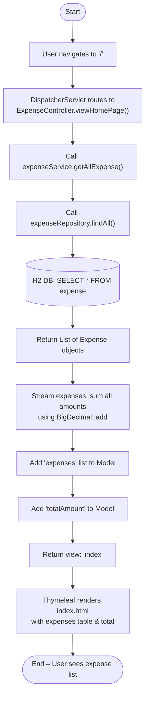
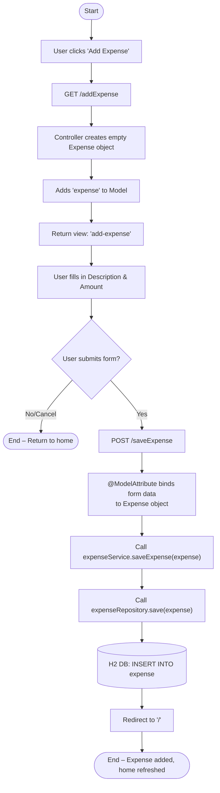
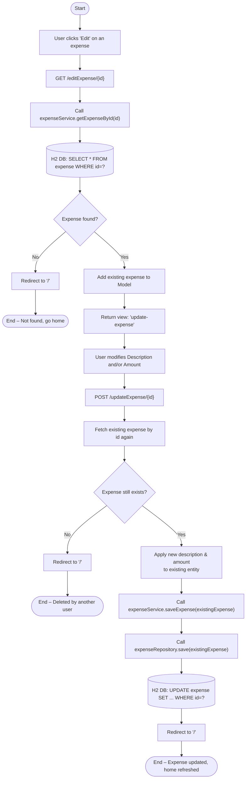
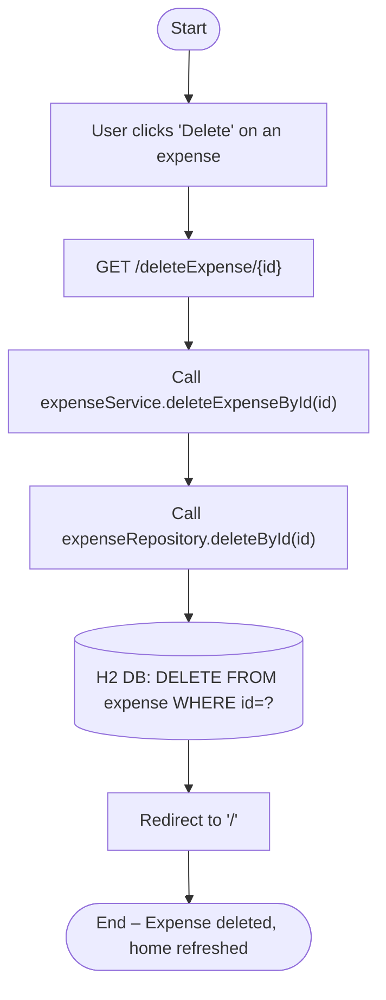
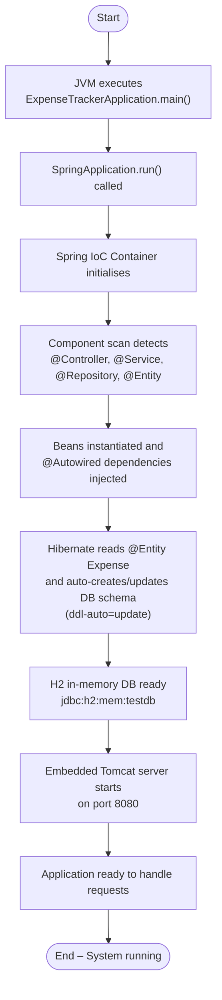

# Activity Diagram – Expense Tracker

> Shows the workflow / control flow for each major user interaction.

---

## 1. View Home Page (GET /)

---

## 2. Add New Expense

---

## 3. Edit / Update Expense

---

## 4. Delete Expense

---

## 5. Application Startup (Spring Boot Bootstrap)

