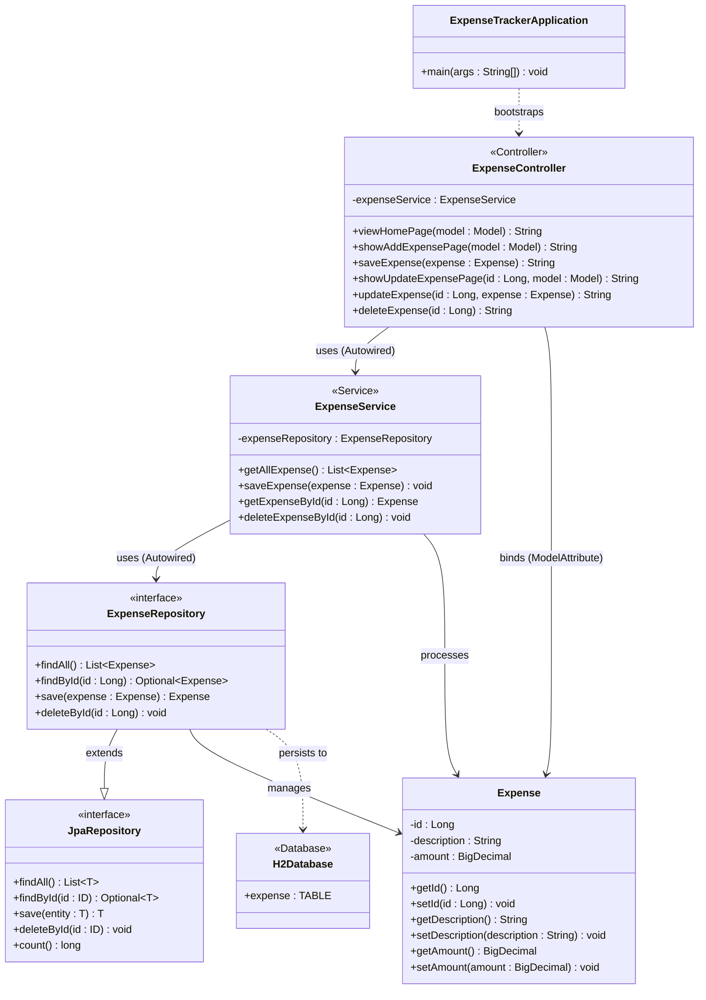

# Class Diagram – Expense Tracker

> Shows all classes, their attributes, methods, relationships, and Spring stereotypes.

## Notes

| Class | Spring Annotation | Layer |
|-------|------------------|-------|
| `ExpenseTrackerApplication` | `@SpringBootApplication` | Entry Point |
| `Expense` | `@Entity` | Model / Domain |
| `ExpenseRepository` | `@Repository` | Data Access (DAO) |
| `ExpenseService` | `@Service` | Business Logic |
| `ExpenseController` | `@Controller` | Presentation / Web |
