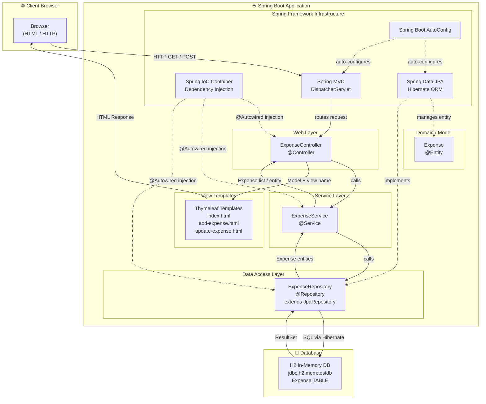

# Component Diagram – Expense Tracker

> Shows major architectural components, their interfaces, and runtime dependencies.

## Component Responsibilities

| Component | Technology | Responsibility |
|-----------|-----------|----------------|
| **ExpenseController** | Spring MVC `@Controller` | Handles HTTP requests, maps routes, calls service |
| **ExpenseService** | Spring `@Service` | Business logic, orchestrates repository calls |
| **ExpenseRepository** | Spring Data JPA `@Repository` | CRUD operations on `Expense` table |
| **Expense** | JPA `@Entity` | Domain model mapped to DB table |
| **Thymeleaf Templates** | Thymeleaf | Server-side HTML rendering |
| **H2 Database** | H2 In-Memory | Stores expense records at runtime |
| **Spring IoC Container** | Spring Core | Manages beans, injects dependencies |
| **Spring MVC** | Spring Web | DispatcherServlet routes HTTP requests |
| **Spring Data JPA** | Hibernate | ORM, generates SQL from entity model |
