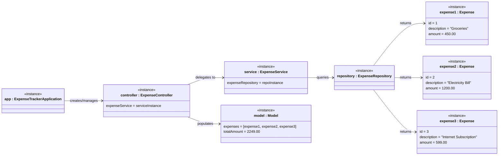

# Object Diagram – Expense Tracker

> Shows concrete runtime instances and their linked values during a typical "view home page" request.

## Runtime State Description

| Instance | Type | Key State |
|----------|------|-----------|
| `app` | `ExpenseTrackerApplication` | Spring context bootstrapped |
| `controller` | `ExpenseController` | Holds injected `service` reference |
| `service` | `ExpenseService` | Holds injected `repository` reference |
| `repository` | `ExpenseRepository` | Proxy managed by Spring Data JPA |
| `expense1` | `Expense` | id=1, "Groceries", ₹450.00 |
| `expense2` | `Expense` | id=2, "Electricity Bill", ₹1200.00 |
| `expense3` | `Expense` | id=3, "Internet Subscription", ₹599.00 |
| `model` | `org.springframework.ui.Model` | expenses list + totalAmount=₹2249.00 |
