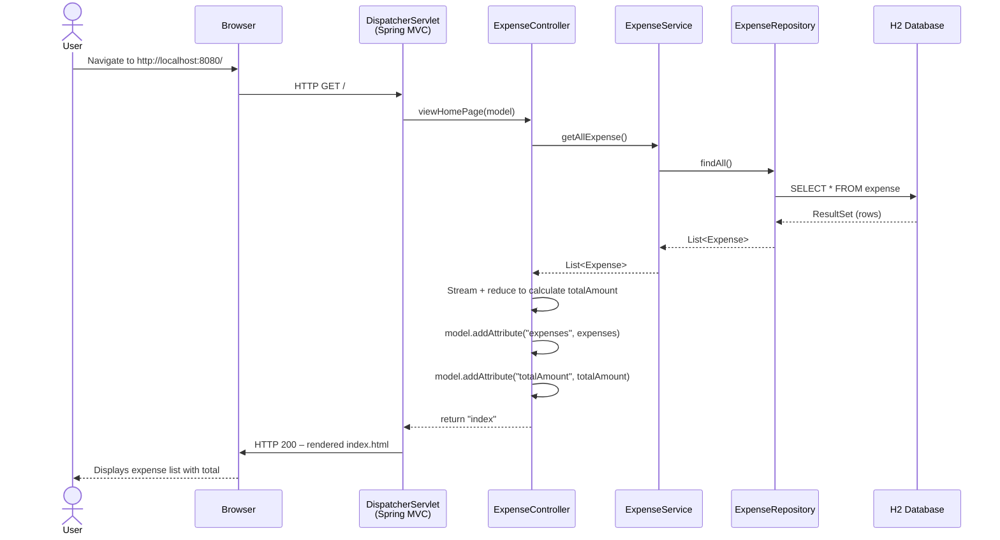
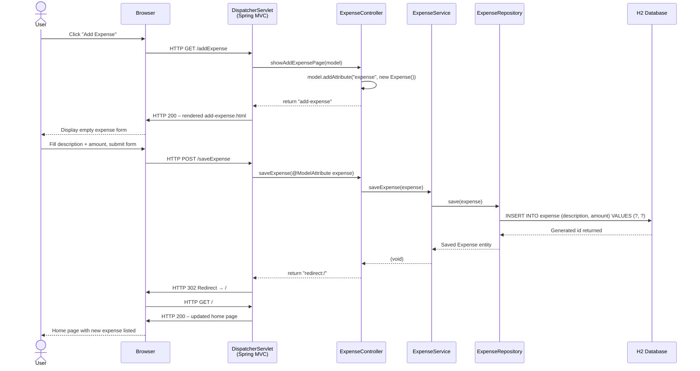
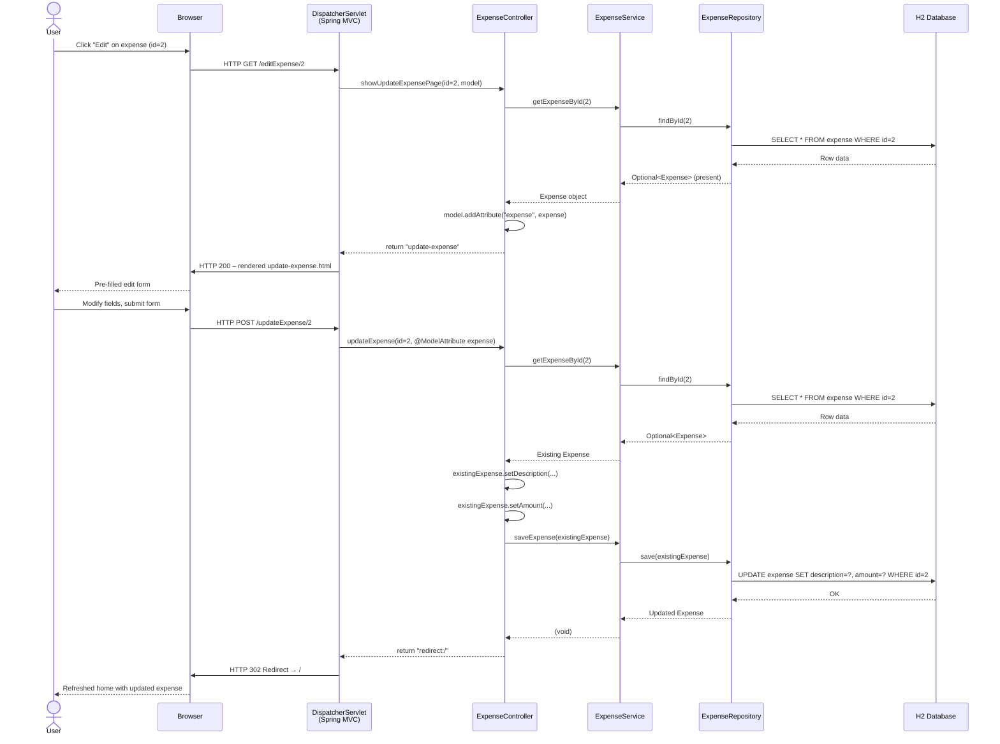
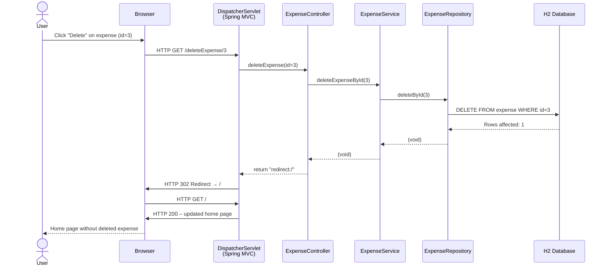
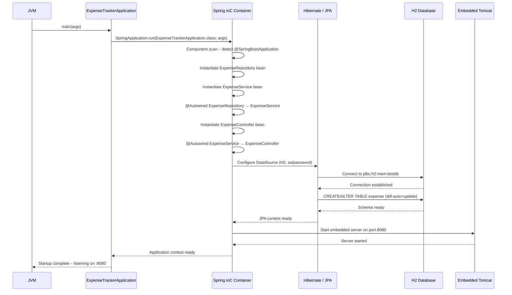

# Sequence Diagram – Expense Tracker

> Shows message exchanges between objects over time for each major operation.

---

## 1. View All Expenses (GET /)

---

## 2. Add New Expense

---

## 3. Edit / Update Expense

---

## 4. Delete Expense

---

## 5. Application Startup Sequence

