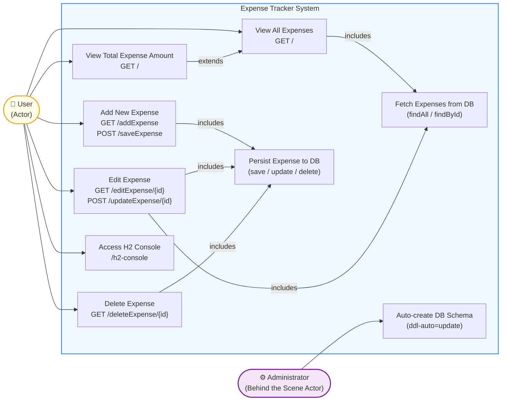

# Use Case Diagram – Expense Tracker

> Shows the actors and all supported system use cases.

## Use Case Descriptions

| Use Case | Actor | Description | HTTP Route |
|----------|-------|-------------|-----------|
| **View All Expenses** | User | Displays a list of all saved expenses | `GET /` |
| **View Total Amount** | User | Shows the sum of all expense amounts | `GET /` (extends View All) |
| **Add New Expense** | User | Opens form and submits a new expense entry | `GET /addExpense` → `POST /saveExpense` |
| **Edit Expense** | User | Opens pre-filled form and submits updated values | `GET /editExpense/{id}` → `POST /updateExpense/{id}` |
| **Delete Expense** | User | Removes an expense record by its ID | `GET /deleteExpense/{id}` |
| **Persist Expense to DB** | System | Save/update/delete an Expense record via JPA | Internal |
| **Fetch Expenses from DB** | System | Retrieve expense records via JPA | Internal |
| **Auto-create DB Schema** | Spring | Hibernate creates/updates `expense` table on startup | Internal |
| **Access H2 Console** | User | Opens the in-memory H2 database admin console | `GET /h2-console` |
